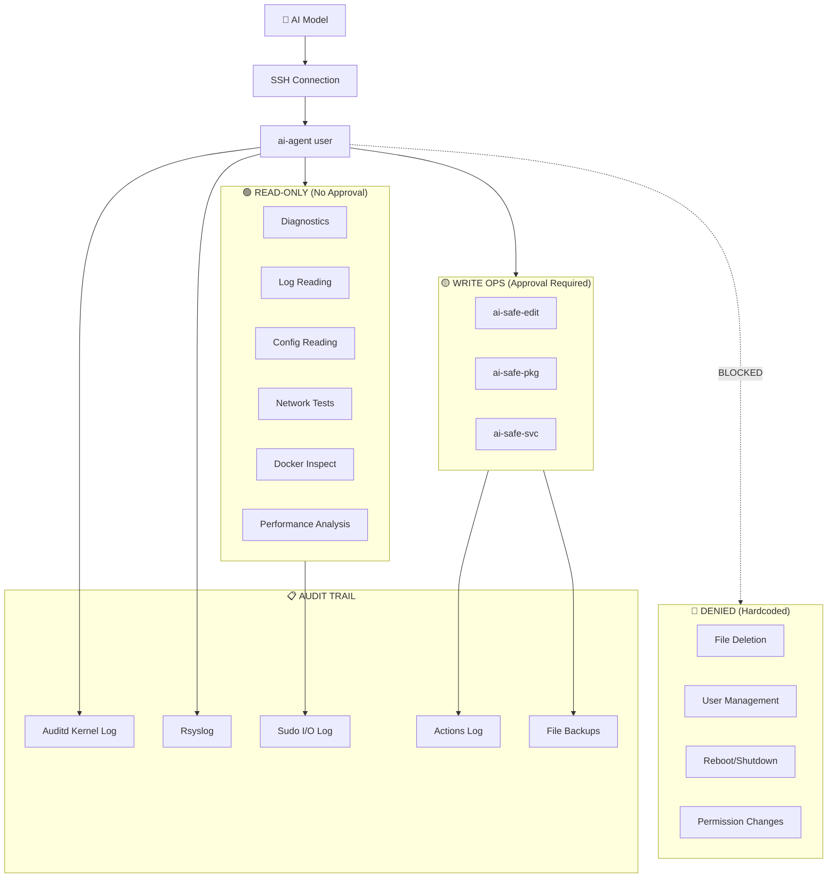
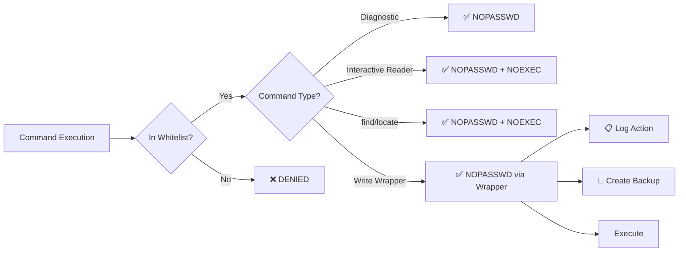

# 🛡️ AI Agent Production Server System — Deployment Plan

> **Note:** This system provides a **secure, audited AI agent** with full **read-only diagnostic access** and **controlled write operations** on a production Linux server. Every action is logged. Every modification requires approval and backup.

---

## Architecture Overview



---

## 📁 File Structure

| File | Deploy To | Purpose |
|------|-----------|---------|
| `sudoers/ai-agent` | `/etc/sudoers.d/ai-agent` | Sudoers whitelist — defines ALL allowed commands |
| `scripts/ai-safe-edit.sh` | `/usr/local/bin/ai-safe-edit` | File editor with mandatory backup + audit |
| `scripts/ai-safe-pkg.sh` | `/usr/local/bin/ai-safe-pkg` | Package manager wrapper with logging |
| `scripts/ai-safe-svc.sh` | `/usr/local/bin/ai-safe-svc` | Service controller with before/after health checks |
| `logging/ai-agent-rsyslog.conf` | `/etc/rsyslog.d/50-ai-agent.conf` | Centralized syslog routing |
| `logging/ai-agent-logrotate.conf` | `/etc/logrotate.d/ai-agent` | Log rotation (90 days retention) |
| `audit/ai-agent-audit.rules` | `/etc/audit/rules.d/99-ai-agent.rules` | Kernel-level audit (every exec, file access, network) |
| `SKILL.md` | `/home/ai-agent/SKILL.md` | AI operations manual (32KB, comprehensive) |
| `README.md` | Reference / Documentation | Comprehensive English technical manual |
| `deploy.sh` | Run once | Automated deployment with verification |
| `uninstall.sh` | Keep for cleanup | Clean removal preserving audit trail |

---

## 🔒 Security Model

### Sudoers Design (Whitelist Only)



### Whitelisted Command Categories

| Category | Commands | NOEXEC | Count |
|----------|----------|--------|-------|
| System Info | `uptime, uname, hostname, lscpu, lsmem, ...` | No | 20 |
| Process/Memory | `ps, top, htop, free, vmstat, lsof, ...` | No | 14 |
| Disk/Storage | `df, du, mount, lsblk, fdisk -l, lvs, ...` | No | 18 |
| Network | `ss, netstat, ip, ping, dig, traceroute, ...` | No | 14 |
| Firewall | `iptables -L/-S, ip6tables, ufw status, nft list` | No | 16 |
| Logs | `journalctl, dmesg, ausearch, aureport` | No | 4 |
| File Reading | `cat, head, tail, grep, find, stat, ls, ...` | Partial | 30 |
| Service Status | `systemctl status/show/cat/list-*` | No | 16 |
| Docker (RO) | `docker ps/logs/inspect/stats/images/...` | No | 24 |
| SSL/TLS | `openssl s_client/x509/verify, certbot` | No | 5 |
| Web Server | `nginx -t/-T, apache2ctl -t/-S` | No | 8 |
| Database | `mysqladmin, pg_isready, redis-cli info, ...` | No | 12 |
| Cron | `crontab -l` | No | 2 |
| Performance | `strace, tcpdump, iostat, sar, perf, ...` | No | 11 |
| Packages (query) | `dpkg -l/-L/-s, apt list/show, rpm -qa, ...` | No | 14 |
| Security | `fail2ban-client, getfacl, aa-status, ...` | No | 10 |

### Safety Mechanisms

| Layer | Mechanism | What It Does |
|-------|-----------|-------------|
| 1 | **Sudoers Whitelist** | Only listed commands can run as root |
| 2 | **NOEXEC tag** | Prevents shell escapes from `less`, `find`, etc. |
| 3 | **Wrapper Scripts** | Enforce backup + logging for all writes |
| 4 | **Sudo I/O Logging** | Full input/output capture of every sudo command |
| 5 | **Auditd Rules** | Kernel-level tracking of all exec, file access, network |
| 6 | **Rsyslog** | Centralized log routing |
| 7 | **Logrotate** | 90-day retention, prevents log disk fill |
| 8 | **SKILL.md** | Behavioral rules the AI model follows |
| 9 | **Locked Password** | No password login, SSH key only |

---

## 📋 Audit Trail — What Gets Logged

| Event | Log File | Detail Level |
|-------|----------|-------------|
| Every sudo command | `/var/log/ai-agent/sudo.log` | Command + args |
| Full I/O of sudo | `/var/log/ai-agent/sudo-io/` | Complete input/output |
| File edits | `/var/log/ai-agent/actions.log` | File path, backup path, diff |
| Package operations | `/var/log/ai-agent/pkg-operations.log` | Package name, action, result |
| Service operations | `/var/log/ai-agent/svc-operations.log` | Before/after state, exit code |
| All command executions | `auditd (ai-agent-exec)` | Every binary executed |
| All file access | `auditd (ai-agent-file)` | Every file opened |
| Network connections | `auditd (ai-agent-net)` | Every connect() syscall |
| Permission changes | `auditd (ai-agent-perm)` | chmod/chown attempts (alert!) |
| File deletions | `auditd (ai-agent-delete)` | unlink/rename attempts (alert!) |

### Quick Review Commands for Operator

```bash
# What did the AI do today?
cat /var/log/ai-agent/actions.log

# Full sudo I/O replay
sudoreplay -l /var/log/ai-agent/sudo-io

# All commands executed (kernel-level)
ausearch -k ai-agent-exec --format text -ts today

# Any suspicious activity?
ausearch -k ai-agent-delete --format text   # Deletion attempts
ausearch -k ai-agent-perm --format text     # Permission changes

# What files were backed up?
find /var/backups/ai-agent -name '*.bak' -ls
```

---

## 🚀 Deployment Steps

### Prerequisites
- Ubuntu/Debian or RHEL/CentOS Linux server
- Root access
- `auditd` installed (recommended): `apt install auditd audispd-plugins`

### Deploy

```bash
# 1. Copy the ai-agent-system directory to the server
scp -r ai-agent-system/ root@<server>:/tmp/

# 2. SSH to server
ssh root@<server>

# 3. Run deployment
cd /tmp/ai-agent-system
chmod +x deploy.sh
sudo bash deploy.sh

# 4. Add SSH key for AI model access
echo '<AI-MODEL-PUBLIC-KEY>' >> /home/ai-agent/.ssh/authorized_keys

# 5. Test
su - ai-agent -c 'sudo uptime'       # Should work (diagnostic)
su - ai-agent -c 'sudo rm /tmp/test'  # Should FAIL (denied)
```

### Uninstall

```bash
chmod +x uninstall.sh
sudo bash uninstall.sh
# Logs and backups are preserved for audit
```

---

## 📖 SKILL.md Highlights

The `SKILL.md` is a **32KB comprehensive operations manual** that includes:

- ✅ **5 Golden Rules** — Non-negotiable safety rules
- ✅ **Full Command Reference** — Every allowed command with usage examples
- ✅ **6 Investigation Playbooks** — CPU, Memory, Disk, Network, Service Down, Docker
- ✅ **Approval Workflow** — Clear decision tree for when to ask vs. proceed
- ✅ **Script Creation Rules** — What's allowed in diagnostic scripts
- ✅ **Report Templates** — How to present findings to the operator
- ✅ **Escalation Triggers** — When to alert immediately
- ✅ **Performance Safety** — Impact ratings for each diagnostic tool
- ✅ **Common Pitfalls** — DO NOT / DO table of dangerous patterns
- ✅ **Quick Decision Tree** — Visual flowchart for any command

---

## 🔧 Wrapper Scripts Summary

### `ai-safe-edit` — File Modifications
- **Mandatory backup** before any change (timestamped in `/var/backups/ai-agent/`)
- **Preserves ownership & permissions** from original file
- **Shows diff** after applying changes
- **Restore command** provided in output
- Supports: edit, append, restore, diff, list-backups

### `ai-safe-pkg` — Package Management
- **Snapshots installed packages** before any install/upgrade
- **Full operation log** with exit codes
- **Detects package manager** automatically (apt/dnf/yum)
- Supports: install, update, upgrade, search, info, history

### `ai-safe-svc` — Service Control
- **Captures before/after state** (active status, PID, memory, uptime)
- **Health check** after restart/start
- **Automatic warning** if service fails to come up
- **Journal tail** included in output
- Supports: restart, reload, start, stop, status
